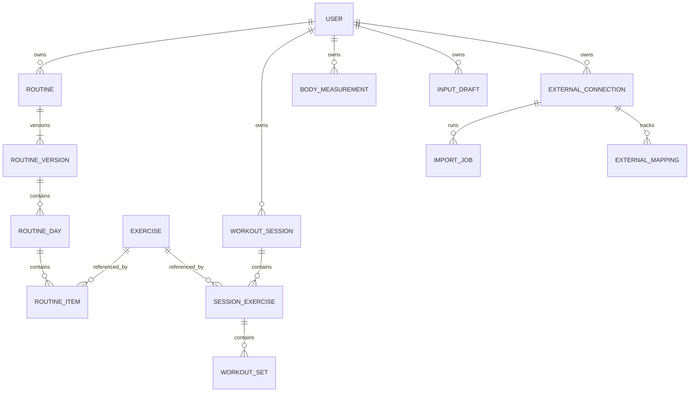

# ERD와 데이터 규칙

## 관계 구조

아래는 앱을 위한 제안입니다. Notion의 열 구조를 그대로 복제하지 않고, 가변 세트와 다중 사용자 사용을 반영합니다.

## 데이터 항목 정의

| 항목 | 주요 필드·규칙 |
|---|---|
| User | id, 표시 이름, 시간대, 단위 설정, 역할, 활성 상태. 인증 세션·비밀번호는 인증 라이브러리 전용 테이블에서 관리 |
| Invitation | 토큰 해시, 초대한 관리자, 대상 이메일 선택값, 만료·사용 시각. 한 번 사용 후 재사용 불가 |
| Exercise | id, owner_id(nullable), 이름, 별칭, 장비, 부위, 수행 방식, 측정 방식, 활성 상태. owner 없는 종목은 공용이며 관리자만 수정 |
| Routine / RoutineVersion | owner_id, 이름, 버전 번호, 생성 시각. 게시된 버전은 불변, 변경은 새 버전 생성 |
| RoutineDay / RoutineItem | 요일, 휴식 여부, 순서, 종목, 목표 세트·반복 범위·RIR·시간, 벤치 각도. 목표 중량은 선택값 |
| WorkoutSession | owner_id, 현지 운동 날짜, 시간대 스냅샷, 시작·종료 시각, 유형, 상태, 실제/테스트, 컨디션·메모, 선택적 루틴 버전 참조, 수정 버전 |
| SessionExercise | session_id, exercise_id, 순서, 종목 이름·장비·목표 스냅샷, 수행 메모. 같은 종목을 별도 블록으로 두 번 수행할 수도 있음 |
| WorkoutSet | session_exercise_id, 순서, 워밍업/본세트, 수행/건너뜀 상태, 개당 중량, 기구 수, 반복, 실제 RIR, 시간·거리, 좌우 구분 |
| BodyMeasurement | owner_id, 측정 시각, 체중, 체지방률 등 선택값 |
| InputDraft | owner_id, 원문, 파싱 결과, 미확인 항목, 직접/AI/Notion 출처, 상태, 파서 버전, 확정된 세션 참조 |
| ExternalConnection | owner_id, 서비스, 외부 워크스페이스 ID, 암호화된 토큰 또는 비밀 저장소 참조, 연결 상태 |
| ExternalMapping | connection_id, 외부 항목 ID, 내부 대상 유형·ID, 원본 수정 시각·해시, 마지막 가져오기 시각·내부 버전 |
| ImportJob | connection_id, 상태, 체크포인트, 성공·실패·충돌 건수. 행별 결과는 ImportItem으로 추적 |
| AiUsage / AuditEvent | 사용자·요청 ID, 사용량·모델·오류 / 작업자·대상·동작·시각. 비밀키와 민감한 원문은 일반 로그에 기록하지 않음 |

금액·중량·거리 등은 Decimal 또는 정수 최소 단위로 저장합니다. 미입력은 NULL이며 0으로 대체하지 않습니다. 날짜만 있는 운동일지와 UTC 시각을 구분하고, ‘어제’는 사용자의 시간대로 해석합니다.

## 세트와 마지막 RIR

`RDL 19kgx2 15 15 15 RIR 2`의 파싱 초안:

| 세트 | 개당 kg | 기구 수 | 반복 | RIR |
|---|---:|---:|---:|---:|
| 1 | 19 | 2 | 15 | NULL |
| 2 | 19 | 2 | 15 | NULL |
| 3 | 19 | 2 | 15 | 2 |

- 종목은 기존 별칭 규칙에 따라 루마니안 데드리프트(RDL)에 매핑합니다.
- 마지막 RIR은 마지막으로 수행한 본세트의 RIR입니다. 단순히 NULL이 아닌 가장 최근 RIR을 보여주지 않습니다.
- 마지막 본세트가 추가되면 이전 세트의 RIR은 그대로 두고, 새 마지막 세트의 RIR이 없으면 ‘미입력’으로 표시합니다.
- ‘마지막 RIR’ 빠른 입력은 현재 마지막 본세트의 RIR을 수정합니다. 독립된 중복 필드로 저장하지 않습니다.
- 가져온 Notion 기록에서 세트 연결이 불명확하면 원문과 원본 필드를 보존하고 검토 대상으로 둡니다.
- 이 예시는 설계 예제이며 실제 운동일지에 저장하지 않습니다.

## 중량·볼륨

기존 Notion은 덤벨 한 개당 kg, 사용 덤벨 수, 좌우 측수를 구분합니다. 앱도 이 의미를 유지합니다.

- 덤벨 2개 동시 수행: `개당 중량 × 2 × 반복`을 세트별 합산.
- 덤벨 1개 좌우 개별 수행: 좌·우 실제 반복을 별도로 보관하고 각 수행의 외부 중량 볼륨을 합산. 이미 좌우가 합산된 반복에 측수를 다시 곱하지 않음.
- 예제 RDL의 단순 외부 중량 볼륨: `19 × 2 × (15+15+15) = 1,710kg`.
- 세트 중량 변경 예: `19×2×15 + 20×2×15 + 20×2×15 = 1,770kg`.
- 맨몸은 외부 중량 0이 운동 부하 0을 의미하지 않으므로 kg 볼륨 대신 반복·시간 중심 표시.
- 바벨은 총중량, 머신은 표시 중량, 보조 중량은 보조량으로 의미를 명시. 서로 다른 장비의 kg 수치를 동일 훈련 강도로 합산·비교하지 않음.
- 드롭세트처럼 한 세트 안에서 무게가 바뀌는 기록은 초기에는 하위 세트 행 또는 명시된 세트 메모로 보존하고 파싱 시 확인.

## 무결성과 소유권

- 사용자 데이터는 서버가 인증된 사용자로 소유자를 결정. 클라이언트가 보낸 owner_id를 신뢰하지 않음.
- 하위 기록은 세션까지 소유권을 확인하고, 다른 소유자의 개인 종목·루틴·연결을 참조하지 못하게 검증.
- 세트 순서: `(session_exercise_id, position, side)` 유일. 각 범위에 맞는 반복·시간·RIR 검증.
- 운동은 하루 여러 번 가능. `(사용자, 날짜, 유형)`을 DB 유일키로 강제하지 않음. 중복 후보 탐지 후 기존 세션 보완 또는 새 세션 선택.
- 저장 요청에는 사용자 범위의 idempotency key 사용. 수정은 버전 비교로 충돌 검출. 세션과 세트 저장은 트랜잭션 처리.
- 종목은 사용 이력이 있으면 비활성화. 이름·루틴 변경은 스냅샷 덕분에 과거 기록에 소급 반영되지 않음.
- 실제/테스트 구분은 세션을 기준으로 집계. 가져온 하위 기록의 구분이 다르면 가져오기 충돌로 처리.
- 외부 매핑의 `(connection_id, external_id, target_type)`는 유일. 하나의 원본이 여러 세트로 분해되는 경우 매핑은 SessionExercise에 두고 하위 세트를 트랜잭션으로 관리.
- 세션 삭제는 복구 가능한 삭제 상태로 시작. 완전 삭제 및 백업 보존 정책은 운영 단계에 명시.

## Notion → 앱 매핑

| Notion | 앱 |
|---|---|
| 운동 종목 | Exercise와 별칭 |
| 주간 루틴 | 개인 RoutineVersion / Day / Item |
| 운동 세션 | WorkoutSession, 유산소는 시간·강도를 가진 별도 수행 항목 |
| 수행 기록의 1~4세트 | SessionExercise 아래 가변 WorkoutSet 행 |
| 기본 중량 + 2~4세트 중량 | 세트 중량: 개별 값 우선, 없으면 기본 중량 |
| 마지막 세트 RIR | 마지막 실제 본세트의 actual_rir |
| 실제총반복 보정·메모 | 원본 보존. 세트·좌우 분배 불명확 시 임의 배분 없이 검토 |

현재 표는 개념·논리 설계이며 실행 가능한 DB 마이그레이션은 다음 구현 단계의 산출물입니다.
