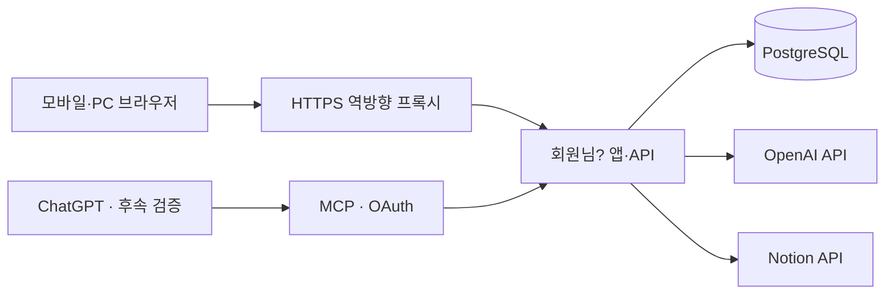

# 연동·권한·NAS 운영 설계

## 연동 경로

ChatGPT에 연결된 Notion 권한은 앱으로 이전되지 않습니다. 앱의 Notion 연결과 AI API 결제·키는 별도로 설정합니다. ChatGPT 프로젝트 내부 대화 자동 가져오기는 초기 범위에 포함하지 않습니다.

## 앱 API 경계

- `/api/exercises`, `/api/routines`: 허용된 공용·개인 종목과 본인 루틴 관리.
- `/api/sessions`: 운동일지 생성·조회. 날짜 범위 및 종목 필터.
- `/api/sessions/:id`: 소유자 확인 후 상세 조회·버전 기반 수정·삭제.
- `/api/input-drafts`: 규칙·AI 파싱 초안. `/confirm`에서만 실제 기록 반영.
- `/api/integrations/notion`: 연결·가져오기 미리보기·작업 생성·상태 확인·연결 해제.
- `/api/admin/invitations`: 관리자 초대 관리.
- 인증·권한·입력 검증·중복 처리 로직은 공통 서비스 계층에 두고 UI·MCP가 함께 호출.

## Notion 가져오기

1. 사용자가 연결하고 대상 페이지·DB에 접근 권한 부여. 개인 테스트는 제한된 통합 토큰, 여러 사용자 배포는 OAuth 지원을 검토.
2. DB 스키마와 관계를 읽어 현재 4개 DB의 실제 속성에 매핑.
3. 종목 → 루틴 → 세션 → 수행 기록 순서로 가져오기 초안 구성.
4. 날짜·중량·RIR·테스트 구분·좌우 반복·원본 관계의 오류를 미리 표시.
5. 확정된 항목만 저장하고 외부 ID와 내부 ID를 매핑. 실패 항목은 개별 재시도.
6. 재가져오기 시 원본·내부 변경을 비교. 앱에서 수정된 기록을 조용히 덮어쓰지 않고 충돌 표시.

원본 ID가 삭제되거나 접근 불가해져도 앱 기록은 자동 삭제하지 않습니다. API 제한 응답은 재시도 지연과 체크포인트로 처리합니다. 원본 JSON과 입력 원문은 접근 통제를 적용하고, 일반 운영 로그에 노출하지 않습니다.

## AI·MCP

- 구조화된 출력이라도 Zod와 도메인 규칙으로 재검증. 알 수 없는 중량·RIR을 추정해 채우지 않음.
- 해당 사용자에게 허용된 기록만 조회하고, 필요한 최소 범위만 AI로 전송.
- 사용자별 요청·사용량 제한, 관리자 월간 예산, 제한 시 직접 기록 유지.
- 외부 텍스트는 데이터로 취급. 원문에 포함된 명령으로 권한·키·DB 접근을 변경하지 않음.
- MCP는 실제 ChatGPT 계정의 연결 지원과 인증 요건을 확인한 뒤 별도 검증. 접근 가능한 HTTPS 주소와 사용자별 OAuth 권한 범위 필요.
- 초기 도구 후보: `list_workouts`, `get_exercise_history`, `prepare_workout_draft`, `confirm_workout_draft`. 기록 쓰기는 초안 확인 흐름을 유지하고 루틴 자동 변경은 제공하지 않음.

## 권한과 인증

- 초대 가입, 안전한 비밀번호 해시·서버 세션·HttpOnly 쿠키·HTTPS 적용.
- 쿠키 기반 쓰기 요청의 CSRF·Origin 검증, 로그인·AI·가져오기 속도 제한.
- 관리자 역할은 초대·운영·사용량 관리에 사용. 다른 사용자의 운동 내용 조회 권한은 기본 부여하지 않음. NAS·DB 운영자는 인프라 접근 권한을 가진다는 한계는 별도 고지.
- 외부 토큰은 서버에서 암호화해 보관. 암호화 키는 이미지·저장소에 넣지 않고 별도 관리·복구 보관.
- 소유자 없는 공용 종목 수정은 관리자만 가능. 요청의 임의 ID로 다른 사용자 데이터에 접근할 수 없도록 서버에서 검증.

## DS423+ 배포

- CPU 대상: `linux/amd64`. 앱은 Node.js LTS standalone 이미지, 비루트 사용자로 실행.
- Compose 서비스: `app`, `db`. DB 포트는 NAS 외부에 공개하지 않고 내부 네트워크로 연결.
- TLS는 기존 Synology 역방향 프록시 또는 별도 프록시를 선택. 실제 도메인·Portainer 네트워크를 확인한 후 구성.
- 기본 DB 영구 저장 경로 예: `/volume1/docker/member-app/postgres`. 실제 공유폴더 경로·권한 확인 후 확정.
- 환경 설정 예: `APP_URL`, `DATABASE_URL`, 인증 비밀값, 토큰 암호화 키, `OPENAI_API_KEY`, Notion OAuth 설정. 이름은 실제 라이브러리 요구에 맞춰 구현 단계에서 확정.
- 앱·DB 상태 점검, 제한된 로그 크기·순환, 재시작 정책, 이미지 태그 고정. `latest`에 의존한 자동 갱신은 초기 운영에서 사용하지 않음.
- 18GB 전체를 앱 자원으로 예약하지 않음. 기존 NAS 부하를 확인하고 앱·DB의 메모리·CPU·응답 시간을 측정해 제한값 결정.

## 배포·업데이트·복구 기준

1. CI 또는 개발 환경에서 amd64 이미지 빌드·검증 후 레지스트리에 버전 태그로 등록.
2. NAS 영구 폴더·비밀 설정·내부 네트워크 준비 후 Portainer Stack 배포.
3. 전용 DB 마이그레이션 작업을 한 번 실행하고 앱 상태 확인. 여러 앱 인스턴스가 동시에 마이그레이션하지 않음.
4. 업데이트 전 논리 백업과 복구 가능 여부 확인. 마이그레이션은 가능한 한 하위 호환으로 작성.
5. 이미지 롤백만으로 DB 변경이 되돌아가지 않음을 고려. 비호환 변경 시 복원 절차와 허용 데이터 손실 범위를 먼저 명시.

초기 백업 정책 제안: 매일 `pg_dump`, 7일 일간·4주 주간·3개월 월간 보관, NAS와 다른 위치에 복제. 실행 중 DB 디렉터리 단순 복사만을 백업으로 간주하지 않습니다. 암호화 키·환경 설정도 별도 안전 보관합니다.

배포 완료 조건은 신규 설치, 앱·NAS 재시작 후 데이터 유지, 외부 HTTPS 인증, 비인가 접근 차단, 새 DB로 백업 복구 성공입니다. 현재 이 문서는 운영 설계이며 실제 이미지·Compose·백업 스크립트는 구현·배포 단계에서 제공합니다.
